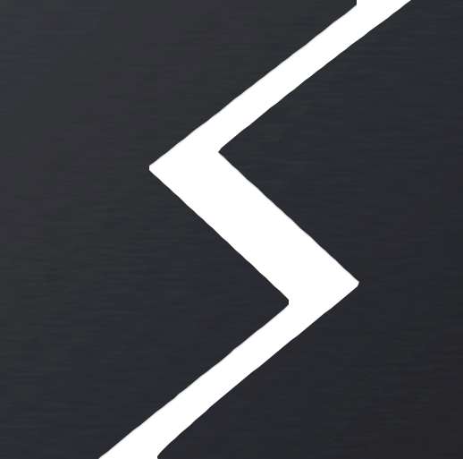
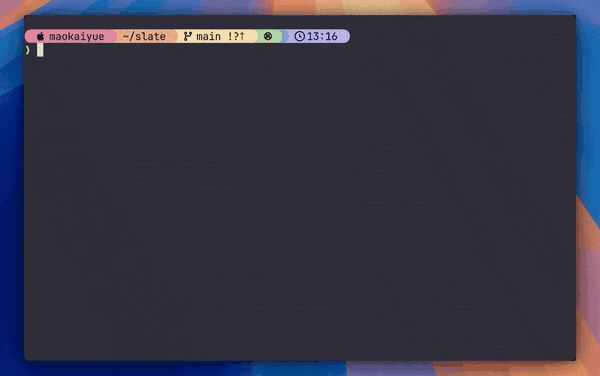
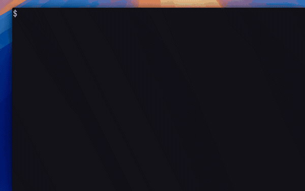
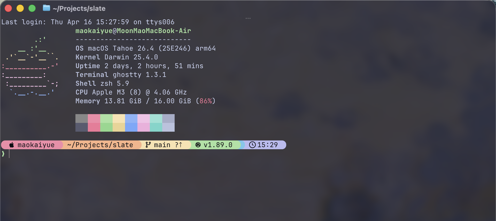
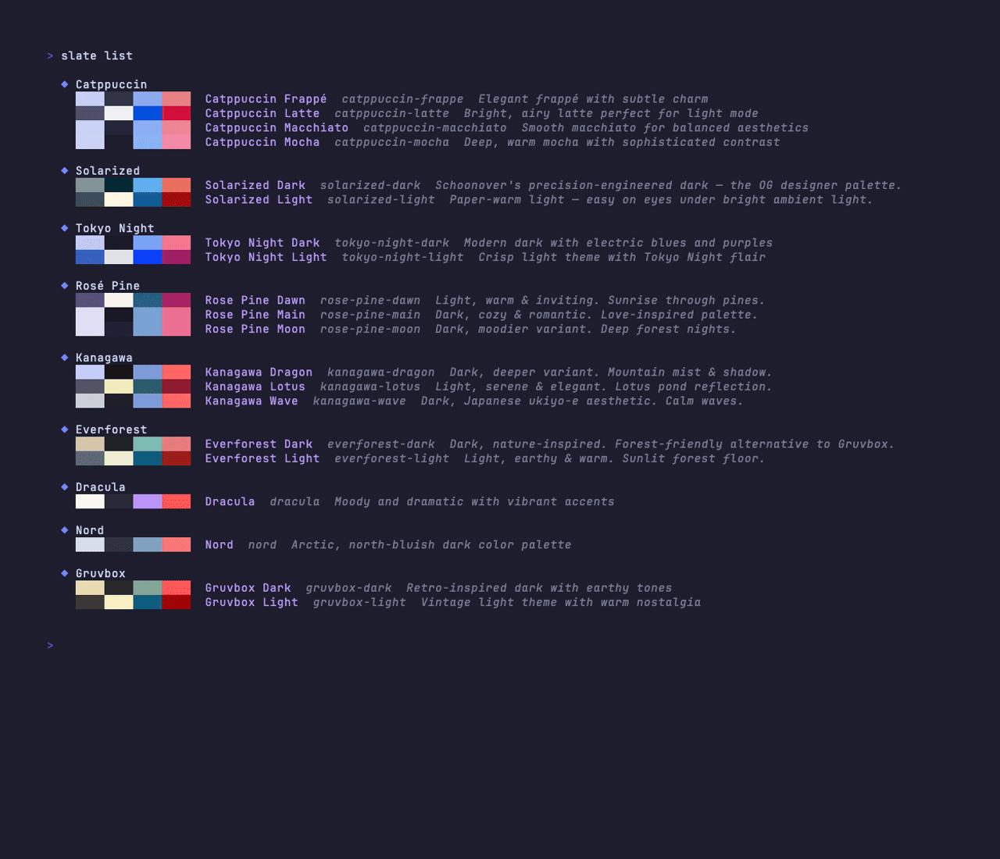

<p align="center">
  
</p>

<h1 align="center">slate</h1>

<p align="center">
  为 macOS 和 Linux 准备的一键终端配置：主题、提示符、字体、周边工具一次性调成同一套。
</p>

<p align="center">
  <a href="./README.md">English</a> · 简体中文
</p>

<p align="center">
  <a href="https://github.com/MoonMao42/slate/releases"></a>
  
  
  
</p>

<p align="center">
  
  <br />
  <sub>选一个主题，slate 把整套终端实时切过去，不用重启。</sub>
</p>

## 为什么做这个

我一直没找到一款真正顺手的终端美化工具。每次想把终端弄漂亮一点，就得去翻别人的 dotfile 仓库、到处抄配置、叠一堆插件。折腾半天，环境可能一团糟还恢复不过来，必须得去研究到底动了什么。

所以我写了 slate：一条命令把终端、提示符、字体、CLI 工具统一调成一套风格；所有 slate 写的东西都放在它自己管的文件里，想卸载就 `slate clean`，是真的干净。

## 安装

```bash
# macOS · Homebrew
brew install MoonMao42/tap/slate-cli

# macOS 或 Linux · 一键脚本
curl -fsSL https://raw.githubusercontent.com/MoonMao42/slate/main/install.sh | sh

# Rust 用户
cargo install slate-cli
```

然后运行 `slate` 进入菜单；只有需要整套终端、字体和 Shell 接入时才运行 `slate setup`。

通过脚本安装的版本，重新运行安装脚本即可升级。脚本会校验归档的 SHA-256，
在目标目录内暂存新文件，然后原子替换旧版本；最后的重命名步骤之前失败时，
旧可执行文件保持不变。若恰好在重命名瞬间中断，目标可能是旧版或完整的新版。
它不会运行下载的程序，也不会修改 Slate 配置；
升级成功后不保留旧可执行文件的备份。如果目标是符号链接，请使用管理它的包管理器
（Homebrew 使用 `brew upgrade slate-cli`），或用 `SLATE_INSTALL_DIR` 选择独立目录。

<p align="center">
  
  <br />
  <sub><code>slate setup</code> 一键配置。</sub>
</p>


## 它做了什么

- 一套配色同步到 Ghostty、Kitty、Alacritty、Neovim、Starship、bat、btop、Yazi、Zellij、delta、ls、eza、lazygit、fastfetch、tmux、zsh-syntax-highlighting。

- 🌓 自动跟随系统深浅色：macOS 走原生 watcher，Linux 优先走 XDG Desktop Portal（GNOME 可退回 `gsettings`）。
- 配色保存在独立文件中，只向现有配置添加必要的集成设置；支持快照和只读恢复预览，便于检查与撤销改动。
- 所有命令共用一套视觉语言。标题、提示符号、树形结果都走同一个渲染契约，所以 `slate setup`、`slate status`、报错信息看起来都像出自一手。
- 主题应用、选择器翻动、配置完成和报错都有轻微反馈音。默认安静设计，不喜欢就 `slate config set sound off`。（README 录屏是无声的；实际运行时已包含反馈音。）

<p align="center">
  
  <br />
  <sub>终端、提示符、系统信息、常用 CLI，全部共用同一套配色。</sub>
</p>

<p align="center">
  
  <br />
  <sub><code>slate list</code> —— 9 个家族分组，Solarized 紧跟在 Catppuccin 后面。</sub>
</p>

<sub>* GitHub README 录屏无声；安装后的 CLI 仍会播放内置反馈音，除非手动关闭。</sub>

## 主题

共 20 款变体、9 个家族：Catppuccin · Solarized · Tokyo Night · Rosé Pine · Kanagawa · Everforest · Dracula · Nord · Gruvbox。

<details>
<summary><strong>20 款变体 · 调色板预览</strong></summary>

使用 `scripts/render-theme-gallery.sh` 重新生成；后续若有漂移，由 `tests/docs_invariants.rs` 兜底。色块顺序从左到右：背景 · 前景 · 品牌强调色 · 红色。

<!-- THEME-GALLERY-START -->
<!-- generated by scripts/render-theme-gallery.sh — do NOT hand-edit; regenerate from themes/themes.toml -->

| 家族 | 变体 | ID | 外观 | 调色板 |
|------|------|----|-----:|--------|
| Catppuccin | Catppuccin Frappé | `catppuccin-frappe` | Dark | <svg width="80" height="14" xmlns="http://www.w3.org/2000/svg"><rect width="20" height="14" x="0" fill="#303446"/><rect width="20" height="14" x="20" fill="#c6d0f5"/><rect width="20" height="14" x="40" fill="#babbf1"/><rect width="20" height="14" x="60" fill="#e78284"/></svg> |
| Catppuccin | Catppuccin Latte | `catppuccin-latte` | Light | <svg width="80" height="14" xmlns="http://www.w3.org/2000/svg"><rect width="20" height="14" x="0" fill="#eff1f5"/><rect width="20" height="14" x="20" fill="#4c4f69"/><rect width="20" height="14" x="40" fill="#7287fd"/><rect width="20" height="14" x="60" fill="#d20f39"/></svg> |
| Catppuccin | Catppuccin Macchiato | `catppuccin-macchiato` | Dark | <svg width="80" height="14" xmlns="http://www.w3.org/2000/svg"><rect width="20" height="14" x="0" fill="#24273a"/><rect width="20" height="14" x="20" fill="#cad3f5"/><rect width="20" height="14" x="40" fill="#b7bdf8"/><rect width="20" height="14" x="60" fill="#ed8796"/></svg> |
| Catppuccin | Catppuccin Mocha | `catppuccin-mocha` | Dark | <svg width="80" height="14" xmlns="http://www.w3.org/2000/svg"><rect width="20" height="14" x="0" fill="#1e1e2e"/><rect width="20" height="14" x="20" fill="#cdd6f4"/><rect width="20" height="14" x="40" fill="#b4befe"/><rect width="20" height="14" x="60" fill="#f38ba8"/></svg> |
| Solarized | Solarized Dark | `solarized-dark` | Dark | <svg width="80" height="14" xmlns="http://www.w3.org/2000/svg"><rect width="20" height="14" x="0" fill="#002b36"/><rect width="20" height="14" x="20" fill="#839496"/><rect width="20" height="14" x="40" fill="#6c71c4"/><rect width="20" height="14" x="60" fill="#ea6e60"/></svg> |
| Solarized | Solarized Light | `solarized-light` | Light | <svg width="80" height="14" xmlns="http://www.w3.org/2000/svg"><rect width="20" height="14" x="0" fill="#fdf6e3"/><rect width="20" height="14" x="20" fill="#3e4d52"/><rect width="20" height="14" x="40" fill="#6c71c4"/><rect width="20" height="14" x="60" fill="#a00d0d"/></svg> |
| Tokyo Night | Tokyo Night Dark | `tokyo-night-dark` | Dark | <svg width="80" height="14" xmlns="http://www.w3.org/2000/svg"><rect width="20" height="14" x="0" fill="#1a1b26"/><rect width="20" height="14" x="20" fill="#c0caf5"/><rect width="20" height="14" x="40" fill="#bb9af7"/><rect width="20" height="14" x="60" fill="#f7768e"/></svg> |
| Tokyo Night | Tokyo Night Light | `tokyo-night-light` | Light | <svg width="80" height="14" xmlns="http://www.w3.org/2000/svg"><rect width="20" height="14" x="0" fill="#e1e2e7"/><rect width="20" height="14" x="20" fill="#3760bf"/><rect width="20" height="14" x="40" fill="#5a4a78"/><rect width="20" height="14" x="60" fill="#9f1f63"/></svg> |
| Rosé Pine | Rose Pine Dawn | `rose-pine-dawn` | Light | <svg width="80" height="14" xmlns="http://www.w3.org/2000/svg"><rect width="20" height="14" x="0" fill="#faf4ed"/><rect width="20" height="14" x="20" fill="#575279"/><rect width="20" height="14" x="40" fill="#907aa9"/><rect width="20" height="14" x="60" fill="#a72464"/></svg> |
| Rosé Pine | Rose Pine Main | `rose-pine-main` | Dark | <svg width="80" height="14" xmlns="http://www.w3.org/2000/svg"><rect width="20" height="14" x="0" fill="#191724"/><rect width="20" height="14" x="20" fill="#e0def4"/><rect width="20" height="14" x="40" fill="#c4a7e7"/><rect width="20" height="14" x="60" fill="#eb6f92"/></svg> |
| Rosé Pine | Rose Pine Moon | `rose-pine-moon` | Dark | <svg width="80" height="14" xmlns="http://www.w3.org/2000/svg"><rect width="20" height="14" x="0" fill="#232136"/><rect width="20" height="14" x="20" fill="#e0def4"/><rect width="20" height="14" x="40" fill="#c4a7e7"/><rect width="20" height="14" x="60" fill="#eb6f92"/></svg> |
| Kanagawa | Kanagawa Dragon | `kanagawa-dragon` | Dark | <svg width="80" height="14" xmlns="http://www.w3.org/2000/svg"><rect width="20" height="14" x="0" fill="#181616"/><rect width="20" height="14" x="20" fill="#c5d0ff"/><rect width="20" height="14" x="40" fill="#8ba4b0"/><rect width="20" height="14" x="60" fill="#ff6666"/></svg> |
| Kanagawa | Kanagawa Lotus | `kanagawa-lotus` | Light | <svg width="80" height="14" xmlns="http://www.w3.org/2000/svg"><rect width="20" height="14" x="0" fill="#f2ecbc"/><rect width="20" height="14" x="20" fill="#545464"/><rect width="20" height="14" x="40" fill="#4d699b"/><rect width="20" height="14" x="60" fill="#8e1b32"/></svg> |
| Kanagawa | Kanagawa Wave | `kanagawa-wave` | Dark | <svg width="80" height="14" xmlns="http://www.w3.org/2000/svg"><rect width="20" height="14" x="0" fill="#1f1f28"/><rect width="20" height="14" x="20" fill="#c8d1d8"/><rect width="20" height="14" x="40" fill="#938aa9"/><rect width="20" height="14" x="60" fill="#ff6666"/></svg> |
| Everforest | Everforest Dark | `everforest-dark` | Dark | <svg width="80" height="14" xmlns="http://www.w3.org/2000/svg"><rect width="20" height="14" x="0" fill="#1e2326"/><rect width="20" height="14" x="20" fill="#d3c6aa"/><rect width="20" height="14" x="40" fill="#a7c080"/><rect width="20" height="14" x="60" fill="#e67e80"/></svg> |
| Everforest | Everforest Light | `everforest-light` | Light | <svg width="80" height="14" xmlns="http://www.w3.org/2000/svg"><rect width="20" height="14" x="0" fill="#efebd4"/><rect width="20" height="14" x="20" fill="#5c6a72"/><rect width="20" height="14" x="40" fill="#8da101"/><rect width="20" height="14" x="60" fill="#9d1f1a"/></svg> |
| Dracula | Dracula | `dracula` | Dark | <svg width="80" height="14" xmlns="http://www.w3.org/2000/svg"><rect width="20" height="14" x="0" fill="#282a36"/><rect width="20" height="14" x="20" fill="#f8f8f2"/><rect width="20" height="14" x="40" fill="#bd93f9"/><rect width="20" height="14" x="60" fill="#ff5555"/></svg> |
| Nord | Nord | `nord` | Dark | <svg width="80" height="14" xmlns="http://www.w3.org/2000/svg"><rect width="20" height="14" x="0" fill="#2e3440"/><rect width="20" height="14" x="20" fill="#d8dee9"/><rect width="20" height="14" x="40" fill="#88c0d0"/><rect width="20" height="14" x="60" fill="#ff7777"/></svg> |
| Gruvbox | Gruvbox Dark | `gruvbox-dark` | Dark | <svg width="80" height="14" xmlns="http://www.w3.org/2000/svg"><rect width="20" height="14" x="0" fill="#282828"/><rect width="20" height="14" x="20" fill="#ebdbb2"/><rect width="20" height="14" x="40" fill="#fe8019"/><rect width="20" height="14" x="60" fill="#ff5555"/></svg> |
| Gruvbox | Gruvbox Light | `gruvbox-light` | Light | <svg width="80" height="14" xmlns="http://www.w3.org/2000/svg"><rect width="20" height="14" x="0" fill="#fbf1c7"/><rect width="20" height="14" x="20" fill="#3c3836"/><rect width="20" height="14" x="40" fill="#af3a03"/><rect width="20" height="14" x="60" fill="#9d0006"/></svg> |

<!-- THEME-GALLERY-END -->

</details>

## 开发说明

借助 AI 辅助开发，每一处改动都经过人工 review 和测试后才合入。

## 许可

MIT。

## 致谢

站在一堆很棒的项目之上：
[Ghostty](https://ghostty.org/) · [Kitty](https://sw.kovidgoyal.net/kitty/) · [Alacritty](https://github.com/alacritty/alacritty) · [Neovim](https://neovim.io/) · [Starship](https://github.com/starship/starship) · [bat](https://github.com/sharkdp/bat) · [delta](https://github.com/dandavison/delta) · [eza](https://github.com/eza-community/eza) · [lazygit](https://github.com/jesseduffield/lazygit) · [fastfetch](https://github.com/fastfetch-cli/fastfetch) · [tmux](https://github.com/tmux/tmux) · [zsh-syntax-highlighting](https://github.com/zsh-users/zsh-syntax-highlighting) · [Nerd Fonts](https://github.com/ryanoasis/nerd-fonts)。
